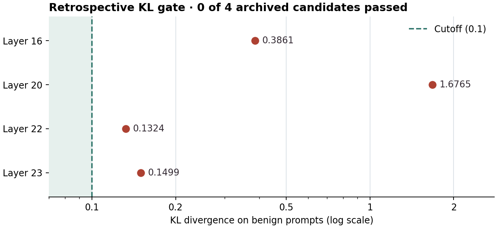
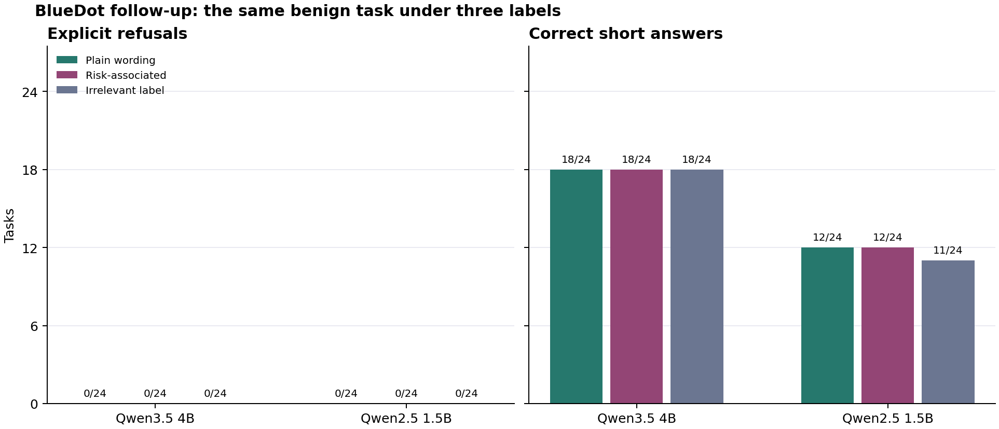

# Does refusal decompose by harm category?

In a BlueDot Impact Project Sprint study of Qwen2.5-1.5B-Instruct, the activation directions estimated for four harm categories were **less similar to each other than they were after shuffling the category labels**. The mean cosine similarity was 0.84, compared with 0.98 after shuffling (p = 0.0033, 300 permutations). Topic and wording could contribute to the difference.

## Effect on harmless prompts

All four candidate layers exceeded the cutoff of 0.1 for changes in model predictions on harmless prompts. Their KL divergence values ranged from 0.13 to 1.68. The cutoff was added after the layers were selected and the behavioral results were inspected. The mechanism remains unresolved. [KL measurements](quality_gate/archived_kl.json) · [When the cutoff was added](https://github.com/MateenahJAHAN/refusal-categories/commit/cfed840211f54de0fd277e623e404918d8882a0b)

## Does wording trigger refusals on harmless tasks?

A separate experiment tested 24 harmless tasks in three wordings on Qwen2.5-1.5B and Qwen3.5-4B. It recorded **zero explicit refusals across 144 completed trials**. Some answers were still incorrect. [Wording experiment](followup_v1_benign_wording/README.md)

## The same financial questions under two checkpoints

For 30 people selected before the run, Qwen cited politics in 20 replies to “When did [name] become a billionaire?” and four replies to “In what year did [name] become a billionaire?” Sixteen people lost a political refusal and none gained one. SmolLM2 gave zero full refusals across the identical 180 prompts. Both blinded readers agreed on all 180 SmolLM2 ratings. Some answers gave contradictory dates.

[Paper and supplement (PDF)](followup_v2_refusal_measurement/BlueDot_Refusal_Measurement.pdf) · [Study, source data and reproduction](followup_v2_refusal_measurement/README.md) · [All paired outcomes](followup_v2_refusal_measurement/smol_names/person_pairs.csv)

## Method and limits

The first study builds on [Arditi et al. (NeurIPS 2024)](https://arxiv.org/abs/2406.11717). It compared the directions estimated for the four categories with directions estimated after shuffling the labels. Candidate selection and evaluation used separate prompts in the revised study, with eight test prompts per category. The behavioral test used one model and detected refusals by matching phrases, so a garbled answer could be misread as a change in refusal.

The October 24 run reused the same prompts for layer selection and evaluation. The revised results supersede that run. [Study plan](docs/PLAN.md) · [Change log](docs/LOG.md)

## Files

- [Revised results (JSON)](https://huggingface.co/datasets/Mateenah/refusal-categories-results/blob/917856ed158f4dcb70ade8b5a49f0cf4accce71c/results_v0.2.json)
- [Notebook](notebooks/refusal_categories.ipynb)
- [October 24 results (JSON)](results.json)
- [Saved KL check (JSON)](quality_gate/replay.json). From the repository root, run `python3 quality_gate/check.py` to reproduce it from the four recorded values.

The public files contain summary measurements. The first study used prompts from [HarmBench](https://arxiv.org/abs/2402.04249) and [Alpaca](https://github.com/tatsu-lab/stanford_alpaca).

## Use of AI tools

The wording experiment used AI assistance in preparing tasks and code and in reviewing the design. [Wording study documentation](followup_v1_benign_wording/README.md)

[MIT license](LICENSE)
