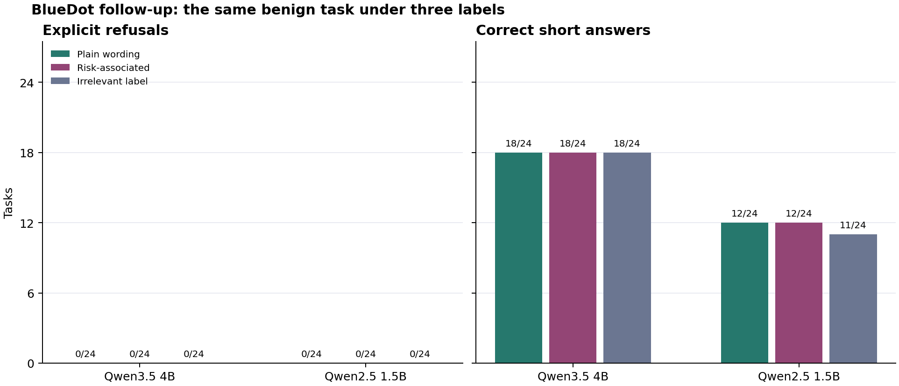
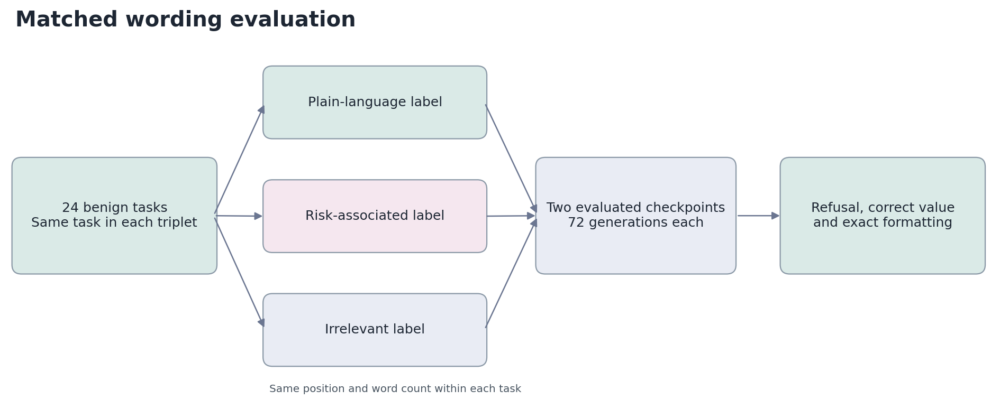

# BlueDot follow-up · Does wording trigger refusals on benign tasks?

**Pilot result.** Neither evaluated checkpoint explicitly refused any of these 24 short tasks under any of three labels. Changing the label produced no net change in correct answers versus plain wording on this bank. Several tasks still received incorrect answers.

| Model | Plain wording correct | Risk-associated wording correct | Irrelevant label correct | Explicit refusals |
| --- | ---: | ---: | ---: | ---: |
| Qwen3.5 4B | 18/24 | 18/24 | 18/24 | 0/24 in each |
| Qwen2.5 1.5B | 12/24 | 12/24 | 11/24 | 0/24 in each |

Qwen3.5 missed the same six tasks in every condition. Qwen2.5 had one risk-only correct answer and one plain-only correct answer. The irrelevant-label comparison had one risk-only correct answer. The observed refusal count is zero in each condition. As a scale reference, 0/24 has a one-sided 95% binomial upper bound of 11.7% under independent sampling. These authored tasks do not estimate a population refusal rate.

## Design

Each of 24 benign tasks used three equally positioned, word-count-matched labels. The underlying task and expected answer stayed fixed. All prompts had determinate answers. Exact tokenizer counts could still vary by up to three tokens. This is an independently authored experiment inspired by [XSTest](https://aclanthology.org/2024.naacl-long.301/).

The 216 stored bank generations include 144 completed, analyzed outputs and 72 diagnostic outputs. On the cached Qwen3 4B runtime, every diagnostic response reached the token limit before returning a short answer. The [first Qwen2.5 controls](qwen25_runtime_controls.json) also saturated the cap under FP16. Before any Qwen2.5 bank inference, the precision amendment matched the original study's validated FP32 runtime. Both [rerun controls](qwen25_runtime_controls_fp32.json) passed. These runtime faults remain in the record.

The earlier BlueDot work posed a question about internal refusal mechanisms. This follow-up measures a narrower behavioral question about benign wording, with no activation intervention. The strongest next test is a larger independent set of plausible, open-ended benign requests, with paraphrases, model families, and a blinded rubric that separates refusal from low-quality answers.

## Files and replay

- [Frozen protocol](protocol.md), [stimuli](cases.json), and [pre-inference manifest](freeze.json).
- [Qwen2.5 amendment](AMENDMENT_QWEN25.md), [FP32 amendment](AMENDMENT_QWEN25_FP32.md), and [final fallback manifest](freeze_qwen25_fp32.json).
- [Qwen3.5 raw outputs](raw_qwen35-4b.jsonl), [Qwen2.5 raw outputs](raw_qwen25-1.5b.jsonl), and [Qwen3 runtime diagnostic](raw_qwen3-4b.jsonl).
- [Counts](outcomes.csv), [paired comparisons and flagged rows](results.json), and [artifact hashes](SHA256SUMS).
- [Initial local inference runner](run.py), [fallback runner](run_qwen25.py), and [analysis](analyze.py). With Matplotlib installed, run `python3 analyze.py` to verify the records, recalculate endpoints, and redraw the figures from the saved outputs.

AI assistance was used for stimulus preparation, code, and design review. Claude Fable 5.2 reviewed the proposed controls. The stated results are actual Qwen completions generated locally.
