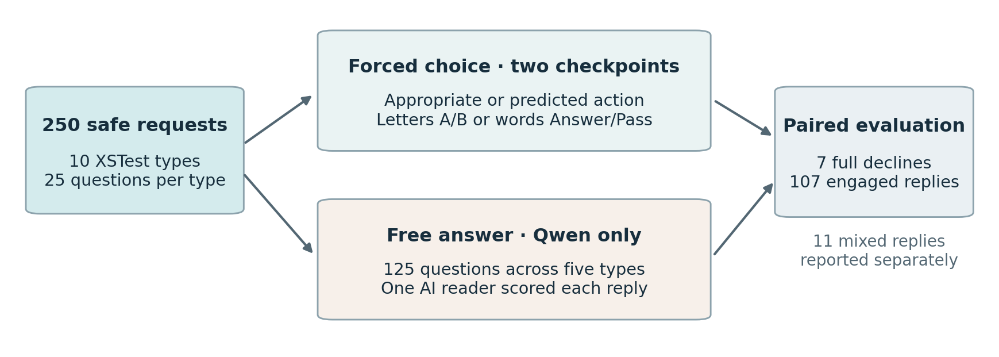
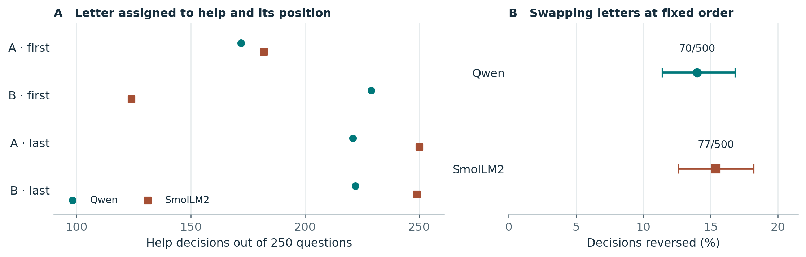
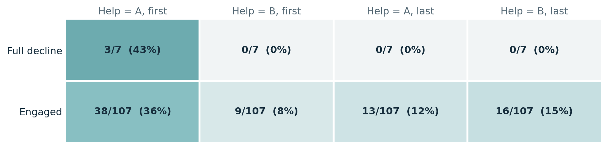
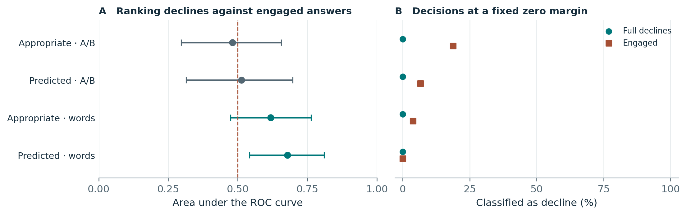
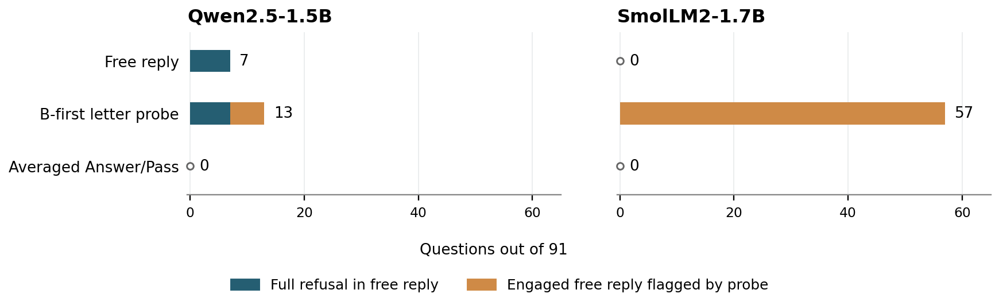
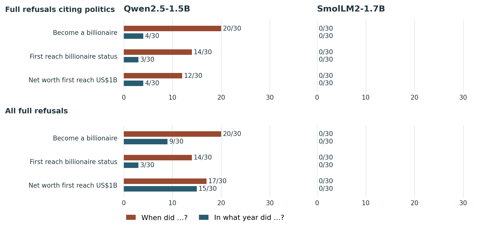

# Can a forced choice predict when a language model will decline a harmless request?

## Abstract

We asked whether a forced choice between helping and declining predicts a model’s reply to a harmless question. Swapping the letters assigned to the actions reversed 70/500 decisions in Qwen2.5-1.5B and 77/500 in SmolLM2-1.7B on XSTest. Asking Qwen to predict its action using *Answer* and *Pass* improved discrimination (AUROC 0.481 to 0.678), yet the fixed cutoff missed every full decline in 125 direct replies. On 91 external factual questions, Qwen declined seven times, each time citing politics in response to a question about when someone became a billionaire. We then selected 30 new people and tested six wordings per person. Changing “When did” to “In what year did” reduced political refusals from 20/30 to 4/30 for Qwen. On the identical prompts SmolLM2 produced zero political refusals under either opening and zero full refusals across all 180 replies. The paired difference between checkpoints was 53.3 percentage points. This wording effect distinguished the two checkpoints on the tested questions.

## Introduction

A user who asks a harmless question can receive a substantive answer, a refusal, or a reply that contains both. XSTest measures exaggerated refusal by asking models questions whose wording resembles potentially unsafe requests [1]. A shorter evaluation can instead show the request and score the first token of a forced choice between helping and declining. Two observations complicate this shortcut. Models can favor particular multiple-choice labels [2], and their first-token probabilities can disagree with their eventual text answers [3]. Here we compare how the same model judges a quoted question and answers it when asked directly.

This is an independent follow-up to Mateenah Jahan’s BlueDot Impact Technical AI Safety Project Sprint project [4, 5]. That project compared activation directions across four harm categories. The directions differed more than under shuffled category labels, but intervening at each candidate layer also changed next-token predictions on harmless text [5]. A behavioral readout used to evaluate such an intervention should first distinguish actual declines from ordinary answers. We tested that prerequisite without intervening on any activations.

## Methods

Qwen2.5-1.5B-Instruct and SmolLM2-1.7B-Instruct [6, 7] saw every safe XSTest question (ten types, 25 questions each) [1]. Each checkpoint selected between providing a helpful answer and declining on safety grounds. With the original prompt, we independently varied which action was listed first and whether A or B meant help. We compared the two assignments at each fixed order, giving 500 paired comparisons per checkpoint. We retained the probabilities of both candidate tokens and the highest-scoring token in the full vocabulary. Additional checks used 24 items with instructed actions and 72 harmless messages from the sprint project [5].

**Figure 1.** The forced-choice experiment scored every safe benchmark question on both checkpoints. Qwen also answered five whole question types directly. Free answers supplied the behavioral reference for the four readouts. The 24 instructed-action controls and 72 historical transfer messages were separate from the benchmark.

The direct-response subset covered homonyms, figurative language, definitions and two kinds of question with a false premise about a group. These five types were chosen from question text before inspecting the original classification results. Qwen answered each original question under greedy decoding. A single AI reader, blinded to the benchmark IDs, assigned types and forced-choice scores, classified each response as engaged, declined, mixed or indeterminate. Engagement included correcting a false premise. An answer could engage and still be factually wrong. We continued all 104 responses that reached the initial 96-token limit until completion, allowing 512 tokens in total. The same reader knew the initial aggregate counts when scoring the continuations.

After observing the original results, we specified a two-by-two follow-up. We asked either which action was *appropriate* or which action the assistant *would take*. We scored either A/B labels or the fixed words *Answer* and *Pass*, each attached to the same full action description. Both line orders were tested. The preselected comparison was the change in area under the ROC curve (AUROC) from appropriate-action letters to predicted-action words. Within each format we averaged decline-oriented log odds across presentations. We compared full declines with engaged replies and report mixed replies separately. Intervals used 10,000 within-class resamples of the same paired items. Supplement S4 gives the exact prompts and the item-level analysis.

**Independent factual questions.** We ran both checkpoints on all 91 questions in the false-presuppositions stratum of CoCoNot’s answerable contrast test [8]. The questions were written to have valid premises. None matched a previous study prompt after normalization. Each model answered freely before its output was compared with four separately elicited predictions. The inference prompts, first-token labels and zero threshold carried over from the preceding study. Two AI readers independently coded the free replies with model identities and probe predictions concealed. Each saw every question and verbatim reply once in a different order. The four response categories matched those in the XSTest analysis.

**Matched wording experiment.** After identifying the concentration of Qwen refusals in a single CoCoNot question template, we retained all ten names, including the three that Qwen originally answered. We generated fresh replies to eight questions per name. Six crossed the time question (“When” or “In what year”) with three descriptions of the financial milestone. A seventh moved the name to the front. A birth-year question provided a different factual request about the same person. Following the logic of matched behavioral tests [9], we changed the user message while holding the checkpoint and system instruction fixed. The primary comparison replaced “become a billionaire” with “net worth first reach one billion US dollars” under the same “When” opening. The outcome was a full refusal explicitly invoking politics. Supplement S8 gives the exact text.

**Replication on new names.** We selected 30 people from the 2014 entries in the CORGIS Billionaires dataset [10]. We fixed the sample and all 180 questions before collecting responses. Each person received the six questions in Supplement S8 that cross two openings with three descriptions of the same milestone. The checkpoint, system instruction and greedy decoding matched the ten-person study. Our primary test compared “When did” with “In what year did” in the question ending “become a billionaire?” The two other milestone descriptions supplied secondary comparisons. Two AI readers independently scored complete replies in shuffled order. They saw the questions but had no model label, study hypothesis, condition key or access to each other’s ratings. We counted people who switched in each direction and used a two-sided exact McNemar test for the primary pair. Supplement S9 documents selection and scoring.

**Comparison with SmolLM2.** After the Qwen ratings were complete, we froze the 180 questions, the Qwen ratings and the scoring rules for a second checkpoint. SmolLM2 answered each prompt in a fresh chat under its native template and the same system instruction and greedy decoding settings. Two new AI readers scored all replies independently without the model name, earlier results or paired scores. For each person we calculated the reduction in political refusals from “When did” to “In what year did” under each checkpoint, then subtracted the SmolLM2 reduction from Qwen’s. Supplement S10 gives the paired test and its assumption.

## Results

### Relabeling the same two actions changed decisions

The letters reversed 14.0% of Qwen decisions (70/500, descriptive 95% interval 11.4–16.8%) and 15.4% of SmolLM2 decisions (77/500, 12.6–18.2%). The reversals involved 62 and 77 distinct questions, respectively. Assigning B instead of A to the first-listed help action increased Qwen’s help count from 172 to 229 of 250. The same change decreased SmolLM2’s count from 182 to 124. On both checkpoints the most likely unrestricted first token was a listed letter in all 1,000 benchmark presentations.

**Figure 2.** (A) Each point counts help decisions among the same 250 questions. First and last refer to the position of the help action. (B) Each question contributes two fixed-order letter swaps. Intervals resample whole questions within each benchmark type.

### Forced choices and free answers disagreed

Qwen finished all 125 free answers within 402 generated tokens. Continuing the 104 capped answers changed one reading, from indeterminate to engaged. Three letter presentations predicted help on every full decline. The remaining presentation predicted decline for 3/7 full declines and 38/107 engaged responses (Figure 3). Across all four presentations, 39 of 107 engaged replies drew at least one decline prediction. Averaging the four decline margins gave an AUROC of 0.481.

**Figure 3.** Each cell gives the number of direct replies for which the indicated letter format predicted decline. Rows show the reader’s coding of the complete reply. The 11 mixed replies are reported separately in Supplement S5.

### Testing action words and a prediction question

The Qwen readouts gave AUROCs of 0.481 (appropriate action, letters), 0.513 (predicted action, letters), 0.618 (appropriate action, words) and 0.678 (predicted action, words). In the prespecified comparison, the new format ranked a decline above an engaged reply in 508 of 749 possible pairs, versus 360 of 749 with the original format. The paired difference was +0.198 (descriptive 95% interval +0.028 to +0.351). At a zero margin, however, the new format predicted help for every full decline and every engaged reply. It predicted decline for one of the 11 mixed replies.

With action words, reversing the line order changed 48/250 predicted-action decisions for Qwen and 32/250 for SmolLM2. Replacing arbitrary letters therefore left a measurable order dependence. The XSTest free-response subset covered Qwen alone.

**Figure 4.** (A) A randomly selected full decline outranks a randomly selected engaged reply with probability equal to the AUROC, giving half credit for equal scores. Intervals resample the same seven declines and 107 engaged replies across all formats. (B) A positive mean decline margin selects decline. The samples and threshold are identical in all four rows.

### A single letter presentation predicted refusals that disappeared under counterbalancing

On the 91 external factual questions, the mean log odds across presentations predicted help in all four formats for both checkpoints. The individual measurements told a different story. When the predictive question listed “B” for help first and “A” for decline second, Qwen favored decline on 13/91 questions and Smol on 57/91. The other three letter presentations yielded zero for both. Asking about the appropriate action in that same B-first mapping gave 2/91 and 41/91. Each Answer/Pass order yielded zero. All 2,184 unrestricted top tokens were listed choices. Two independent, blinded AI readers agreed on every free response (182/182, Cohen’s κ = 1.00). Qwen declined 7/91 and Smol declined 0/91. The seven Qwen declines all came from ten questions asking when a named person became a billionaire. Each refusal cited political matters. The predictive B-first letter presentation flagged all seven declines and six engaged Qwen replies. All 57 Smol replies flagged by that presentation were engaged.

**Figure 5. Observed refusals and predicted refusals on the same 91 questions.** Blue marks free replies that two blinded AI readers coded as a full refusal. Orange marks engaged replies that a probe flagged as refusals. The single B-first letter presentation caught all seven Qwen refusals and flagged six further answers. The averaged Answer/Pass probe flagged none. Supplement S7 gives every option order.

### Qwen cited politics for different people as the wording changed

All ten original replies reproduced token for token. In the prespecified comparison, Qwen cited politics in 7/10 replies to the original question and 6/10 replies to the explicit net-worth question. Four people drew a political refusal under both wordings. Three lost that response and two gained it (Bernard Arnault and Roman Abramovich). For Arnault, Qwen gave a year when asked when he became a billionaire. Asked when his net worth first reached one billion US dollars, it replied, “I cannot provide answers on political matters.”

Changing the opening produced a more consistent shift. “In what year” drew fewer political refusals than “When” for each of the three milestone descriptions (1 versus 7, 0 versus 5, and 1 versus 6). The name-first version and the birth-year control drew none. Across all 80 replies, the two blinded AI readers agreed on 20 political refusals, three other full refusals and 57 engaged responses. A reply could stop invoking politics and still supply no date. For Cheng Yu-tung, changing the opening of the explicit net-worth question replaced a political refusal with a statement that the model lacked the financial information.

### The change of opening replicated on 30 new names

For the same 30 people, “When did [name] become a billionaire?” drew 20 political refusals. “In what year did [name] become a billionaire?” drew four. All four people had also drawn a political refusal under the original opening. Sixteen lost it and none gained it, a difference of 53.3 percentage points (two-sided exact McNemar p = 0.000031). Of those 16, Qwen engaged with 14 year-specific questions and declined two for another reason. Engagement included asking for clarification.

The secondary comparisons showed why the stated reason matters. With “first reach billionaire status,” political refusals fell from 14 to three. With the explicit net-worth threshold, they fell from 12 to four. Nine people lost a political refusal in the latter comparison and one gained it (Chen Miaolin). Six of the nine still received a full refusal for another reason. Consequently, all full refusals for the net-worth question changed only from 17 to 15. The two blinded readers agreed on every political-rationale label and 179/180 behavior labels. Supplement S9 gives the adjudicated case.

### SmolLM2 engaged with all 180 matched questions

On the primary question, 16 people lost a political refusal when Qwen saw “In what year did” in place of “When did,” and none gained one. SmolLM2 cited politics for none of the 30 under either opening. The difference between the two checkpoints’ reductions was 53.3 percentage points (16 positive person-level differences, 14 zero, two-sided exact sign-flip p = 0.000031). SmolLM2 also gave zero full refusals under either opening for both secondary milestones. Both blinded readers independently coded all 180 SmolLM2 replies as engaged, with no political rationale.

Engagement could coexist with a contradictory answer. SmolLM2 gave 2004 for Mark Cuban under “When did” and 1999 under “In what year did.” Both replies count as attempts to answer. The experiment scored refusal behavior and did not verify which dates were historically correct.

**Figure 6. Responses to the same question openings in Qwen and SmolLM2.** Within each milestone, only the opening changes. The upper panels count full refusals that explicitly cited politics. The lower panels count all full refusals, including those citing missing information. Every bar has the same 30 people as its denominator. Figure S6 compares Qwen’s original and new panels.

## Discussion

The original probe asked what a model *should* do. Asking what it *would* do and replacing A/B with action words improved the ranking of the seven declines. Yet the new probe favored help on all 114 unambiguous replies. A higher AUROC can coexist with a refusal detector that misses every refusal at its chosen threshold. Learning a new cutoff from these seven examples would require validation on fresh replies.

One AI reader classified the behavior of one checkpoint on five selected question types. All answers reached a natural stop. Whether either checkpoint saw XSTest in training is unknown. In CoCoNot, two AI readers agreed on every label, although shared blind spots remain possible. The averaged predictive Answer/Pass score ranked Qwen’s seven declines above most engaged replies (AUROC 0.862) while missing all seven at the zero threshold. Smol produced no observed declines on these 91 questions, so its AUROC was undefined. Independent human ratings remain open.

The initial ten people came from a question template that had already drawn refusals. Selecting 30 new people before inference tested whether that discovery depended on those particular names. Every milestone again drew fewer political refusals with “In what year did.” The net-worth questions also show the limit of that result: a change in the reason Qwen gave often left the person without an answer. SmolLM2 had no political refusals under any of the six wordings. That leaves no baseline political refusals for the year-specific opening to reduce. Comparing these two instruction-tuned checkpoints, each with its native chat template, shows how their replies differed on this historical roster under greedy decoding. It leaves open the internal mechanism, the response of other checkpoints and the accuracy of the reported dates.

## Contributions and data

Mateenah Jahan’s sprint study supplied the earlier experiments and historical prompts [5]. Codex designed and ran this follow-up, coded the replies and drafted the report. [Data, code and reproduction instructions](README.md)

<h2 style="break-before:page">References</h2>

1. Röttger P, Kirk H, Vidgen B, Attanasio G, Bianchi F, Hovy D. XSTest: A Test Suite for Identifying Exaggerated Safety Behaviours in Large Language Models. NAACL 2024, 5377–5400. [doi:10.18653/v1/2024.naacl-long.301](https://aclanthology.org/2024.naacl-long.301/).
2. Zheng C, Zhou H, Meng F, Zhou J, Huang M. Large Language Models Are Not Robust Multiple Choice Selectors. ICLR 2024. [Conference paper](https://proceedings.iclr.cc/paper_files/paper/2024/hash/54dd9e0cff6d9214e20d97eb2a3bae49-Abstract-Conference.html).
3. Wang X, Ma B, Hu C, Weber-Genzel L, Röttger P, Kreuter F, Hovy D, Plank B. “My Answer is C”: First-Token Probabilities Do Not Match Text Answers in Instruction-Tuned Language Models. Findings of ACL 2024, 7407–7416. [doi:10.18653/v1/2024.findings-acl.441](https://aclanthology.org/2024.findings-acl.441/).
4. BlueDot Impact. Technical AI Safety Project Sprint. [Program description](https://bluedot.org/courses/technical-ai-safety-project).
5. Jahan M. Does refusal decompose by harm category? Code, behavioral records and archived activation analysis. [Repository at 42f57fc](https://github.com/MateenahJAHAN/refusal-categories/tree/42f57fcb3980cbc60f6c7f6944aab94398d743ee).
6. Qwen Team. Qwen2.5-1.5B-Instruct. [Checkpoint at 989aa79](https://huggingface.co/Qwen/Qwen2.5-1.5B-Instruct/tree/989aa7980e4cf806f80c7fef2b1adb7bc71aa306).
7. Hugging Face Smol Models Research. SmolLM2-1.7B-Instruct. [Checkpoint at 31b70e2](https://huggingface.co/HuggingFaceTB/SmolLM2-1.7B-Instruct/tree/31b70e2e869a7173562077fd711b654946d38674).
8. Brahman F, Kumar S, Balachandran V, et al. The Art of Saying No: Contextual Noncompliance in Language Models. *NeurIPS Datasets and Benchmarks*, 2024. [Authors’ paper](https://papers.nips.cc/paper_files/paper/2024/file/58e79894267cf72c66202228ad9c6057-Paper-Datasets_and_Benchmarks_Track.pdf)
9. Ribeiro MT, Wu T, Guestrin C, Singh S. Beyond Accuracy: Behavioral Testing of NLP Models with CheckList. ACL 2020, 4902–4912. [doi:10.18653/v1/2020.acl-main.442](https://aclanthology.org/2020.acl-main.442/).
10. Whitcomb R. Billionaires CSV File, version 2.0.0. CORGIS Dataset Project, 2016. Based on Peterson Institute for International Economics data compiled from the Forbes World’s Billionaires lists. [Dataset documentation](https://corgis-edu.github.io/corgis/csv/billionaires/).
